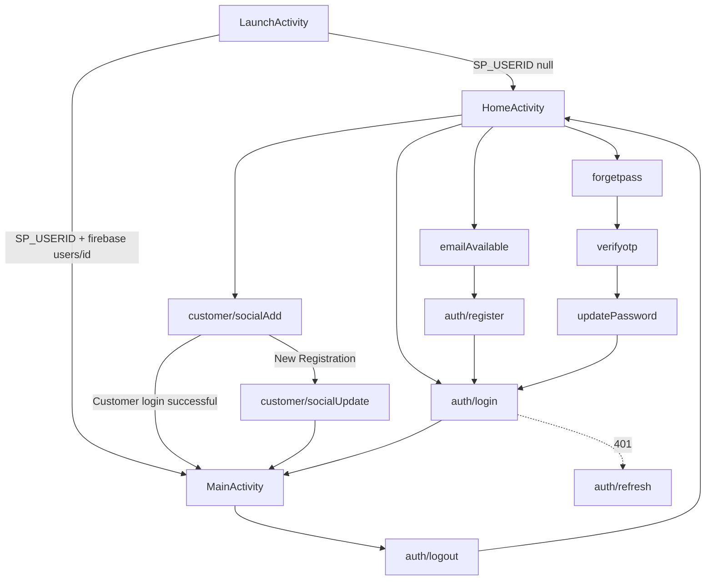
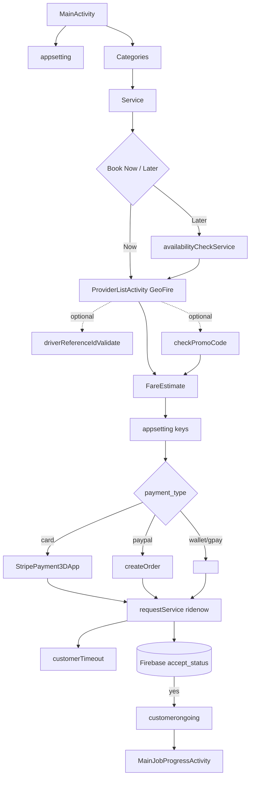
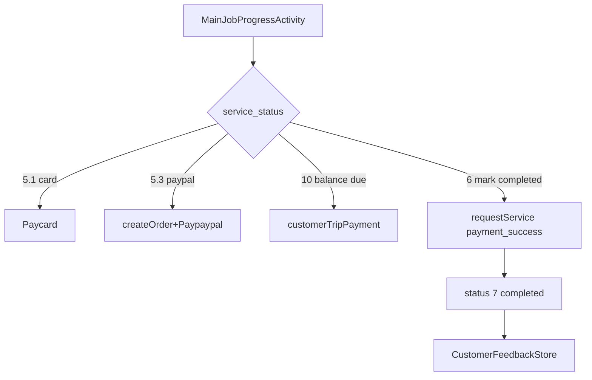
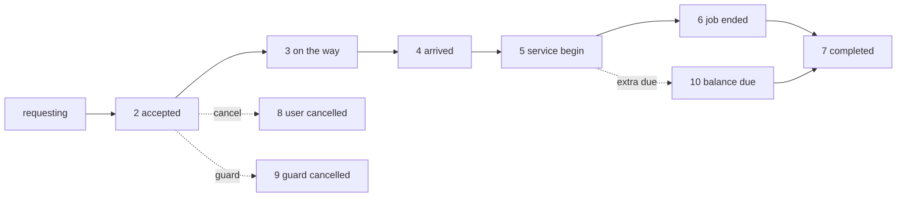

# InstaGuard User App — API Documentation

> **The authoritative API reference for the Flutter rewrite.** Every endpoint below was read
> from `Helpers/Retrofit/APIInterface.java` and its call sites. Request keys are the **exact
> literal strings** put into the `@FieldMap HashMap`. Response fields come from the model classes
> (see [`USER_DATA_MODELS.md`](./USER_DATA_MODELS.md)).

## Conventions

- **Base URL:** `https://backend.insta-guard.co.uk/api/v3/` (all endpoints below are relative to this unless noted).
- **Content type:** every POST is `application/x-www-form-urlencoded` (Retrofit `@FormUrlEncoded`, `@FieldMap HashMap<String,Object>`). Values are strings. **No JSON request bodies. No multipart.** Images/documents are **Base64 strings in form fields**.
- **Auth header column** — exactly how the `Authorization` header is built at the call site:
  - `Bearer` = `"Bearer " + accessToken` (from `SP_USER_ACCESSTOKEN`)
  - `none` = no Authorization header (user identified by `customer_id`/`id`/`user_id` in body)
  - `""` = empty string literal passed as header
  - `"token"` = literal placeholder string (Stripe endpoints)
  - `raw` = the access token passed **without** the `Bearer ` prefix
  - `Accept` / `Content-Type` headers noted where present (`application/json`).
- **Success detection:** HTTP `200` or `201` **AND** `response.body().getMessage()` equals the quoted string. Preserve these strings.
- **401** → `auth/refresh {id, token}` → retry; 2nd 401 → logout.

---

# PART A — Authentication & Account

### A1. Login
**Endpoint:** `auth/login`  **Method:** `POST`  **Auth:** `none`
**Request body:**
```
email        = <email OR phone, lowercased>
password     = <password>
device_token = <FCM token, default "123">
type         = "app"
```
**Response:** `LoginNewModel` → `{ message, result: { result.customer: UserData, access_token, token_type, expires_in } }`
**Success:** `message == "loggedin successfully"`.
**After success:** store `access_token`→`SP_USER_ACCESSTOKEN`, `token_type`→`SP_USER_TOKENTYPE`, `expires_in`→`SP_USER_TOKENEXPTIME`, `UserData.id`→`SP_USERID`, profile fields, `SP_USER_SOCIAL_LOGIN_TYPE="normal"`; query Firebase `currency/<code>` → `SP_CURRENCY_COMMON_VALUES`; → `MainActivity`.
**Errors:** 200 + other message → snackbar(message); 401 → "invalid credentials"; 500 → error snackbar.
**Used by:** `LoginFragment.CallLoginDetails()` (host `HomeActivity`).

### A2. Register
**Endpoint:** `auth/register`  **Method:** `POST`  **Auth:** `none`
**Request body:**
```
first_name    = <name>
last_name     = <name>
email         = <email>
country_code  = "+44" (etc., with +)
phone_number  = <phone>
password      = <password>
device_token  = <FCM token, default "123">
referral_code = <optional>
```
**Response:** `RegisterModel` → `{ message, result: RegisterData }`  **Success:** `message == "Registered Successfully"`.
**After success:** writes Firebase `users/<id>`, navigates to **Login** (no auto-login, no token stored).
**Preceded by:** A3 `emailAvailable`.
**Used by:** `RegisterFragment.CallRegisterDetails()`.

### A3. Email / phone availability
**Endpoint:** `emailAvailable`  **Method:** `POST`  **Auth:** `none`
**Request:** `phone_number`, `email`, `mode="customer"`
**Response:** `EmailMobileCheckingModel` → `{ message, email_available:Boolean, phone_number_available:Boolean }`
**Branch:** `"Email or Phone Number not exists in our db."` → proceed to register; `"Phone Number already exists."` / `"Email already exists."` → error.
**Used by:** `RegisterFragment.callMobileEmailChecking()`.

### A4. Social login / exists-check
**Endpoint:** `customer/socialAdd`  **Method:** `POST`  **Auth:** `none`
**Request:** `social_id`, `social_type` (`facebook|google|twitter|linkedin`), `device_id` (FCM token, default "123")
**Response:** `SocialLoginModel` → `{ msg, result: SocialLoginDataModel, access_token, token_type, expires_in }`
**Branch:** `"New Registration"` → open Social Signup; `"Customer login successful."` → login (or signup if email empty); `"Email already exists."` → toast.
**⚠️ Bug:** Home path persists placeholder tokens `"1256"`/`"32556"` instead of the real `access_token`.
**Used by:** `HomeActivity.checkSocialId()`.

### A5. Social signup completion
**Endpoint:** `customer/socialUpdate`  **Method:** `POST`  **Auth:** `none`
**Request:** `customer_id`, `email`, `phone_number`, `country_code`, `device_id`, `name` (first name), `last_name`, `referral_code`
**Response:** `SocialSignupModel` → `{ id, result: SocialSignupData, msg }`  **Success:** `msg == "User Details"`.
**Used by:** `SocialSignupFragment.CallRegisterDetails()`.

### A6. Forgot password — send OTP
**Endpoint:** `forgetpass`  **Method:** `POST`  **Auth:** `none`
**Request:** `email`, `mode="customer"`
**Response:** `ForgetPassModel` → `{ message, result: ForgetPassData }`  **Success:** `"Mail sent successfully"`.
**Used by:** `ForgotPasswordFragment.callForgotPasswordDetail()` (resend = same endpoint).

### A7. Verify OTP
**Endpoint:** `verifyotp`  **Method:** `POST`  **Auth:** `none`
**Request:** `email`, `mode="customer"`, `otp`
**Response:** `VerifyOtpModel` → `{ message, result: VerifyOtpData (has id) }`  **Success:** `"Code verified successfuly"` → capture `result.id`.
**Used by:** `ForgotPasswordFragment.callConfirmOtpDetail()`.

### A8. Reset password
**Endpoint:** `updatePassword`  **Method:** `POST`  **Auth:** `none`
**Request:** `id` (from A7), `password`, `mode="customer"`
**Response:** `ResetPasswordModel` → `{ id, message }`  **Success:** `"Customer password updated successfuly."` → Login.
**Used by:** `ForgotPasswordFragment.callResetPasswordUpdate()`.

### A9. Change password (logged in)
**Endpoint:** `auth/passwordChange`  **Method:** `POST`  **Auth:** `Bearer`
**Request:** `id`, `old_password`, `new_password`
**Response:** `ChangePasswordModel` → `{ message }`  **Success:** `"Password updated successfully."` → save new pwd to `SP_USER_PASSWORD`.
**Used by:** `EditSettingsFragment.callChangePasswordDetail()`.

### A10. Refresh token
**Endpoint:** `auth/refresh`  **Method:** `POST`  **Auth:** `none` (headers `Accept`=`Content-Type`=`application/json`)
**Request:** `id`, `token` (current access token)
**Response:** `RefreshTokenModel` → `{ access_token, token_type, expires_in }`
**Behaviour:** on 200/201 overwrite token keys and re-invoke the original call; on 401 → force logout.
**Used by:** many fragments as the 401-retry mechanism.

### A11. Logout
**Endpoint:** `auth/logout`  **Method:** `POST`  **Auth:** `none`
**Request:** `id`, `token`
**Response:** `LogoutModel` → `{ message }`  **Success:** `"Successfully logged out"` → clear `MY_PREFS_NAME` → `HomeActivity`.
**Used by:** `MainActivity.CallLogout()`.

### A12. Delete account — request OTP
**Endpoint:** `delete_account_request`  **Method:** `POST`  **Auth:** `none`
**Request:** `id`, `type="customer"`, `mobile_type="android"`, `token`
**Response:** `DeleteModel` → `{ message, result_message, data: DeleteData (email, unique_code) }`  **Success:** `"successfully unique code sent to mail"`.
**Used by:** `SettingsFragment.CallDeleteAccount()`.

### A13. Delete account — confirm
**Endpoint:** `delete_account_confirm`  **Method:** `POST`  **Auth:** `none`
**Request:** `id`, `type="customer"`, `unique_code`
**Response:** `DeleteModel`  **Success:** `result_message == "success"` → set `SP_USER_DELETE_ACCOUNT="1"`, clear prefs, logout.
**Used by:** `SettingsFragment.callVerifyOTP()`.

### A14. App settings (bootstrap config)
**Endpoint:** `appsetting`  **Method:** `POST` (no body)  **Auth:** `none`
**Response:** `AppSettingWebModel` → `{ data:[], app_setting: AppSetting, sms_templates:[], currency:[AppSettingCurrencyModel], language:[AppSettingLanguageModel], message }`  **Success:** `"App settings listed successfully."`
**Stores into prefs:** `payment_publisher_key`→`SP_COMMON_STRIPE_PUBLISH_KEY`, `payment_secret_key`→`SP_COMMON_STRIPE_SECRET_KEY`, `distance_limit`→`SP_COMMON_DISTANCE_LIMIT`, `distance_unit`→`SP_COMMON_DISTANCE_UNIT`, `timeout_delay`→`SP_COMMON_REQUEST_TIME_DELAY_ACCEPT`, `tawk_url`/`property_url`/`property_id`→`SP_COMMON_TOWK_*`, `customer_manage_document`→`SP_COMMON_CUSTOMER_MANAGE_DOCUMENT`; populates currency & language pickers; `vat_percentage`, `paypal_*` used at payment time.
**Used by:** `HomeActivity`, `MainActivity`, `ProviderListActivity`, `MainJobProgressActivity`, `StripePaymentFragment` (call it **early**).

### A15. LinkedIn user info (3rd-party)
**Base:** `https://api.linkedin.com/v3/`  **Endpoint:** `userinfo`  **Method:** `GET`  **Auth:** `Bearer` (LinkedIn token)
**Response:** `LinkedInUserDetailsModel` → feeds `checkSocialId(..., "linkedin", ...)`.

---

# PART B — Profile

### B1. View profile
**Endpoint:** `profileView`  **Method:** `POST`  **Auth:** `Bearer` + `Accept: application/json`
**Request:** `id`, `token`
**Response:** `ProfileModel` → `{ data: ProfileData, rating:Double, message }`  **Success:** `"Profile listed successfully."`
**Used by:** `SettingsFragment`, `EditSettingsFragment`, `SubscriptionPlanFragment` (reads active subscription block).

### B2. Update profile
**Endpoint:** `updateprofile`  **Method:** `POST`  **Auth:** `Bearer`
**Request:** `id`, `first_name`, `last_name`, `email`, `phone_number`, `country_code`, `currency` (dob/gender/address/language **not** sent)
**Response:** `ProfileUpdateModel` → `{ data: ProfileUpdateData (incl. currency_symbol), message }`  **Success:** `"Customer updated successfully."`
**After:** save to prefs + mirror to Firebase `users/<id>`.
**Used by:** `EditSettingsFragment.callUpdateProfileDetail()`.

### B3. Upload profile picture
**Endpoint:** `picupload`  **Method:** `POST`  **Auth:** `Bearer`
**Request:** `id`, `file_binary_data` (**Base64 JPEG, quality 100**), `avatar` (existing path)
**Response:** `ProfilePicModel` → `{ data: ProfilePicData (avatar), message }`  **Success:** `"customer updated successfully."`
**Used by:** `EditSettingsFragment`.

---

# PART C — Discovery (Category / Service / Fare / Availability / Banners)

### C1. Categories (guard types)
**Endpoint:** `Categories`  **Method:** `POST`  **Auth:** `Bearer` + `Accept` + `Content-Type` (both `application/json`)
**Request:** `language` (`"en"`, `"ar"`, …)
**Response:** `VehicleCategoryModel` → `{ message, result:[VehicleCategoryData] }`  **Success:** `"categories listed successfully."`
**VehicleCategoryData:** `id, category_name, category_name_spanish, category_image, category_type, level_type, level_amount`.
**Used by:** `MainActivity.getOnlineCategoryInfo()`.

### C2. Services (sub-categories)
**Endpoint:** `Service`  **Method:** `POST`  **Auth:** `Bearer` + `Accept`
**Request:** `id` (category id), `language`
**Response:** `VehicleSubCategoryModel` → `{ message, result:[VehicleSubCategoryData] }`  **Success:** `"categories services listed successfully."` (empty: `"No records Found."`)
**VehicleSubCategoryData:** `id, category_id, service_name(+_french/_spanish/_swati), service_image, fixed_fare, base_fare, visit_fare, price_per_hour, price_per_km, price_per_agent, price_per_day, price_per_min, user_cancellation_charge, user_cancellation_time, admin_commission, amount_type, status, has_level, Level_entry, book_guard_min_time`.
**Used by:** `MainActivity.getOnlineSubCategoryInfo()`, `SubCategoryFragment`.

### C3. Fare estimate
**Endpoint:** `FareEstimate`  **Method:** `POST`  **Auth:** `""` (empty)
**Request:** `service_id`, `customer_id`, `total_agent`; if scheduled: `type="ridelater"`, `start_date_time`, `end_date_time`; `promocode` (code or `""`)
**Response:** `FareEstimateModel` → `{ message, result: FareEstimateData }`  **Success:** `"success"`.
**FareEstimateData:** `promo_discount, promo_status, promo_code, base_fare, total_hrs, price_per_hr, price_per_guard, total_guard_amount, before_vat_amount, overall_total, wallet_status, wallet_amount, subscription_status, subscription_percentage, subscription_amount, sub_total`.
**⚠️ All pricing is server-side** — client echoes `overall_total`→`total_amount`, `before_vat_amount`→`vat_amount`, `total_hrs`, `price_per_hr` into the booking. Fields are `Object`-typed (number or string) — parse defensively.
**Used by:** `ProviderListActivity.callFareEstimate()`.

### C4. Extend-hours fare
**Endpoint:** `ExtraCalFare`  **Method:** `POST`  **Auth:** `""` (empty)
**Request:** `customer_id`, `booking_id`, `hrs`
**Response:** `FareEstimateModel` (same shape)  **Success:** `"success"`.
**Used by:** `MainJobProgressActivity.callExtendedPaymentView()`.

### C5. Availability check (scheduled)
**Endpoint:** `availabilityCheckService`  **Method:** `POST`  **Auth:** `Bearer` + `Accept`
**Request:** `day`, `hour`, `service` (sub-category id), `pick_lat`, `pick_lon`
**Response:** `CheckAvailablityModel` → `{ message, result (CSV of driver ids) }`  **Success:** `"available Drivers"` (else `"no available Drivers"`).
**After:** save `result`→`B_SCH_TRIP_DRIVERID`, navigate to provider list (loads exactly those guard ids).
**Used by:** `ScheduleTripFragment.callCheckAvailablity()`.

### C6. Guard reference/unique-id validate
**Endpoint:** `driverReferenceIdValidate`  **Method:** `POST`  **Auth:** `none` (⚠️ body is `HashMap<String,String>`)
**Request:** `reference_id`
**Response:** `UniqeIdResModel` → `{ message, result: List<String> }`  **Success:** `"success"` → IDs appended to `MainActivity.uniqueIdList`.
**Used by:** `GuardUniqueIdFragment.validateCall()`.

### C7. Banners
**Endpoint:** `getbanners`  **Method:** `POST`  **Auth:** `Bearer`
**Request:** `mode` (`"all"`)
**Response:** `BannerModel` → `{ message, data:[BannerData] }`  **Success:** `"Success"`.
**BannerData:** `id, banner_id, images, status, title, description, created_at, updated_at`.
**Used by:** `MainActivity.callSlideBannerImage()`.

---

# PART D — Booking (create / timeout / promo / settle / extend / cancel)

> See [`USER_BOOKING_FLOW.md`](./USER_BOOKING_FLOW.md) for the full flow, sequence, and status lifecycle.

### D1. Create booking  ★ CRITICAL
**Endpoint:** `requestService`  **Method:** `POST`  **Auth:** `none`
**Request body (immediate "Book Now"):**
```
mode                = "ridenow"
reference_id        = <comma-joined guard unique ids, or "">
category            = <B_CATEGORY_ID>
customer_id         = <SP_USERID>
service_id          = <B_SUB_CATEGORY_ID>           // the sub-category/service
special_instruction = <comment>
customer_lat        = <pickup lat>
customer_lon        = <pickup lng>
customer_location   = <pickup address>
drop_location       = "NoDrop"
drop_lat            = "0"
drop_lon            = "0"
payment_type        = "wallet" | "stripe" | "stripe_gpay" | "paypal"
stripe_token        = <payment token / paypal order id>   // omitted for wallet
language            = "en"
total_hrs           = <FareEstimate.total_hrs>
price_per_hr        = <FareEstimate.price_per_hr>
vat_amount          = <FareEstimate.before_vat_amount>
total_amount        = <FareEstimate.overall_total>          // the charged amount
emergency_msg       = <B_CATEGORY_TELL_US_EMERGENCY>
total_agent         = <guard count, default "2">
subscription_status = "1" | "0"
discount_amount     = <FareEstimate.subscription_amount | "0">
discount_percentage = <FareEstimate.subscription_percentage | "0">
promocode           = <valid code | "">
```
**Scheduled ("Book Later") adds:** `start_date, start_time, end_date, end_time, start_date_time, end_date_time, trip_type="2"`.
**Response:** `SendRequestModel` → `{ success, message, service_request: ServiceRequest (booking_id:Integer, job_number, request_status, service_status, …) }`
**Success:** `"Request saved successfully."` → read `service_request.booking_id`, show requesting dialog, start countdown, call **D2 customerTimeout**, and listen to Firebase `users/<id>/trips/accept_status`. (`"Driver is not available"` → no-guard toast.)
**Used by:** `ProviderListActivity.CallRequestBooking()`.

### D2. Arm request timeout
**Endpoint:** `customerTimeout`  **Method:** `POST`  **Auth:** `none`
**Request:** `booking_id`, `type="app"`
**Response:** `BankModel` → `{ message }`
**Used by:** `ProviderListActivity.calltimeout()` (right after D1 success).

### D3. Check promo code
**Endpoint:** `checkPromoCode`  **Method:** `POST`  **Auth:** `Bearer` + `Accept`
**Request:** `promocode`, `customer_id`
**Response:** `CheckPromoModel` → `{ message, result: CheckPromoData (discount %, discount_type, validity, …) }`
**Branch:** `"Valid Promocode"` → accept + re-run FareEstimate with promo; `"Invalid Promocode."` / `"Expired Promocode."` / `"Usage limit exceeded for this Promocode."` → reject.
**Used by:** `ProviderListActivity.checkPromoRequest()`.

### D4. Settle payment (job complete)
**Endpoint:** `requestService`  **Method:** `POST`  **Auth:** `Bearer`
**Request:** `mode="payment_success"`, `booking_id`, `driver_id`
**Response:** `BalanceWalletAddMoneyModel`  **Success:** `"Money debited successfully."`
**Used by:** `MainJobProgressActivity.callPaymentFinish_()` (Mark-as-Completed, status 6).

### D5. Cancel a pending "request" booking
**Endpoint:** `requestService`  **Method:** `POST`  **Auth:** `Bearer` + `Accept`
**Request:** `customer_booking_id`, `mode="customer_cancel"`
**Response:** `UpcomingCancelJobsModel`  **Success:** `"Cancelled successfully."` / `"Customer Cancel successfully."`
**Used by:** `YourJobsUpcomingFragment.cancelUpcomingJobs_request()`.

### D6. Extend hours (commit + settle)
**Endpoint:** `UpdateJob`  **Method:** `POST`  **Auth:** `none`
**Request:** `booking_id`, `extended_hrs`, `extended_vat`, `extended_amount`, `extended_status="1"`, `payment_type`, `stripe_token`
**Response:** `SendRequestModel`  **Success:** `"Request saved successfully."`
**Preceded by:** C4 `ExtraCalFare`.
**Used by:** `MainJobProgressActivity.CallRequestBooking()` (extend variant).

### D7. Cancel active booking
**Endpoint:** `cancelJobs`  **Method:** `POST`  **Auth:** `Bearer`
**Request:** `booking_id`, `reason=""`, `mode="customer"`, `language`
**Response:** `CancelJobModel` → `{ data: CancelJobDataModel, message }`  **Success:** `"Cancelled successfully."` → `MainActivity`.
**Allowed:** only in service_status 2/3/4 (cancel button hidden from 5+). Charge/refund computed server-side.
**Used by:** `MainJobProgressActivity.callCancelJobUserUpdate()`.

### D8. Cancel scheduled/upcoming booking
**Endpoint:** `scheduledcancelJobs`  **Method:** `POST`  **Auth:** `Bearer` + `Accept`
**Request:** `booking_id`, `reason` (e.g. `"Job Cancel"`), `mode="customer"`, `language`
**Response:** `UpcomingCancelJobsModel` → `{ booking_id, message }`  **Success:** `"Cancelled successfully."`
**Used by:** `OnGoingJobsFragment.cancelUpcomingJobs()`, `YourJobsUpcomingFragment.cancelUpcomingJobs()`.

### D9. Rating & review
**Endpoint:** `CustomerFeedbackStore`  **Method:** `POST`  **Auth:** `Bearer` + `Accept`
**Request:** `from_id` (user id), `job_id` (booking id), `to_id` (driver id), `rating`, `status="0"`, `feedback` (comment)
**Response:** `RatingDriverModel` → `{ message }`  **Success:** `"Feedback received"` → set Firebase `rating_status=1`.
**Used by:** `MainJobProgressActivity.callUpdateDriverRating()`, `YourJobsPastFragment` (past-job rating; note: past-job path uses literal `"Bearer 123"` header — see gotcha).

---

# PART E — Jobs History

### E1. Ongoing jobs
**Endpoint:** `customerongoing`  **Method:** `POST`  **Auth:** `Bearer`
**Request:** `customer_id`, `language`
**Response:** `OnGoingJobsModel` → `{ success, service_request:[OnGoingJobsData], message }`  **Success:** `"Fetching ongoing job successful."`
**Row tap:** status 13 → confirm-cancel (D8); status 21 → timeout→cancel (D7); else → `MainJobProgressActivity` (`from="ongoing"`, `booking_id`, `customer_location`).
**Used by:** `OnGoingJobsFragment`.

### E2. Upcoming / request jobs (PAGINATED)
**Endpoint:** `CustomerUpcomingJob`  **Method:** `POST`  **Auth:** `Bearer` + `Accept`
**Request:** `customer_id`, `offset` (int, starts 0)
**Response:** `RideHistoryModel` → `{ result:[RideHistoryData], message, page, next_page:Integer }`  **Success:** `"UpcomingJob listed successfully."`
**Pagination:** infinite scroll; page size **8**; if page < 8 items → no more; else `offset = next_page`.
**Used by:** `YourJobsUpcomingFragment.getUpcomingJobsCall()`.

### E3. Past jobs
**Endpoint:** `pastjobs`  **Method:** `POST`  **Auth:** `Bearer` + `Accept`
**Request:** `user_id`, `mode="customer"`, `language` (no pagination)
**Response:** `PastJobsModel` → `{ success, service_request:[PastJobsData], message }`  **Success:** `"Fetching past jobs successful."`
**Used by:** `YourJobsPastFragment`.

### E4. Upcoming jobs (LEGACY — dead)
**Endpoint:** `upcomingJobs`  **Method:** `POST`  **Auth:** `Bearer` + `Accept`
**Request:** `user_id`, `mode="customer"`, `language`  **Response:** `UpcomingJobsModel` (adapter binding commented out — not used).

> **Key-naming inconsistency:** ongoing/upcoming-offset/transaction use `customer_id`; past/legacy-upcoming use `user_id`; subscription history uses `cus_id`. Keep per-endpoint.

---

# PART F — Wallet

### F1. Wallet transactions
**Endpoint:** `Transaction`  **Method:** `POST`  **Auth:** `Bearer` + `Accept`
**Request:** `customer_id`, `language`
**Response:** `WalletAllModel` → `{ data:[WalletAllData], message }`  **Success:** `"Transactions listed successfully."` (empty: `"No records Found."`; 401 → refresh)
**WalletAllData:** `id, transaction_token, customer_id, driver_id, transaction_type (credit/debit), transaction_date, transaction_amount:Double, transaction_mode (card/stripe/wallet/stripe_gpay/paypal), card_number, transaction_notes(+_ar), transaction_status, created_at, updated_at`.
**Filtering:** All / Money-In (`type∈{credit,Credit}`) / Money-Out (`type∈{debit,Debit}`) — **client-side**.
**Used by:** `YourWalletTransAll/MoneyIn/MoneyOutFragment`.
**Balance itself** is read from **Firebase** `users/<id>/wallet` + `/balance_amount` (not a REST call).

### F2. Add money — `customerAddMoney`  ⚠️ DISABLED
**Endpoint:** `customerAddMoney`  **Method:** `POST`  **Auth:** `Bearer`
**Intended request:** `customer_id`, `transaction_amount`, `transaction_token`, `transaction_mode="card"`, `card_number`, `language`
**Response:** `WalletAddMoneyModel` → `{ success, service_request, wallet_balance, balance_amount, message }`  **Success:** `"Money added in wallet successfully."`
**Status:** The tokenization + call in `StripePaymentFragment` are **commented out** — no active wallet top-up in this build.

---

# PART G — Payments (Stripe / PayPal / balance)

> See [`USER_BOOKING_FLOW.md`](./USER_BOOKING_FLOW.md#payment) for which runs per payment type and per status.

### G1. Stripe — create PaymentIntent (one-time, 3DS)
**Endpoint:** `StripePayment3DApp`  **Method:** `POST`  **Auth:** `"token"` (literal placeholder)
**Request:** `customer_id`, `amount`, `save_card` (`"0"`/`"1"`)
**Response:** `PaymentIntentModel` → `{ client_secret, result: { id } }`
**Confirm:** SDK `ConfirmPaymentIntentParams.createWithPaymentMethodCreateParams(params, client_secret)` → `PaymentLauncher.confirm()` (3DS2, 10s timeout). Publishable key from `SP_COMMON_STRIPE_PUBLISH_KEY` (DEBUG fallback `pk_test_...`).
**Used by:** `MainJobProgressActivity.callPaymentIntent_API()`.

### G2. Stripe — save-card SetupIntent flow
**Endpoint:** `StripeSaveCardPayment3DApp`  **Method:** `POST`  **Auth:** `"token"`
**Request:** `customer_id`, `amount`, `type="trip"`
**Response:** `SaveWalletPaymentIntentModel` → `{ client_secret, payment_intent_id, action_url, action_url_status, wallet_status, result: { id, payment_method } }`
**Confirm:** if `action_url_status=="1"` → load `action_url` (URL-decoded) in WebView for 3DS; else Google Pay `presentForSetupIntent(client_secret, "GBP")`.
**Used by:** `MainJobProgressActivity.callSaveUpdateDetails()`.

### G3. Stripe — save-card SetupIntent create (DECLARED, not called)
**Endpoint:** `CreateSaveCardSetupIntent`  **Auth:** `"token"`  → `PaymentIntentModel`. No active caller.

### G4. Stripe — wallet recharge capture (DECLARED, dead)
**Endpoint:** `CaptureWalletRecharge`  **Auth:** `"token"`  → `WalletPaymentIntentModel { client_secret, result:{id} }`. No active caller.

### G5. Card payment at job end
**Endpoint:** `Paycard`  **Method:** `POST`  **Auth:** `Bearer`
**Request:** `booking_id`, `amount`, `card_number`, `strip_token`
**Response:** `BalanceWalletAddMoneyModel`  **Success:** `"Money debited successfully."` → Firebase `card_status=1`.
**Used by:** `MainJobProgressActivity.callCardPaymentAmount()`.

### G6. PayPal — create order
**Endpoint:** `createOrder`  **Method:** `POST`  **Auth:** `Bearer`
**Request:** `booking_id`, `type="app_end"`, `amount`
**Response:** `PayPalCreateModel` → `{ id, message, status }`  **Success:** `"Order Created"` → `PayPalNativeCheckoutRequest(id, email)` → native checkout.
**Used by:** `MainJobProgressActivity.callCreatePayPalPayment()`.

### G7. PayPal — confirm payment
**Endpoint:** `Paypaypal`  **Method:** `POST`  **Auth:** `Bearer`
**Request:** `booking_id`, `amount`, `payment_id`
**Response:** `BalanceWalletAddMoneyModel`  **Success:** `"Money debited successfully."` → Firebase `paypal_status=1`.
**Used by:** `MainJobProgressActivity.callPayPalPaymentAmount()`.

### G8. Balance-amount top-up (extra due, status 10)
**Endpoint:** `customerTripPayment`  **Method:** `POST`  **Auth:** `Bearer`
**Request:** `driver_id`, `customer_id`, `transaction_token`, `booking_id`, `balance_amount`, `total_amount`, `card_number`
**Response:** `BalanceWalletAddMoneyModel` → `{ service_request: BalanceWalletAddMonetDataModel (customerWalletBalance, driverWalletBalance, balanceAmount), message }`  **Success:** `"Request status updated successfully."`
**Used by:** `MainJobProgressActivity.callPaymentBalanceAmount()`.

---

# PART H — Notifications / Chat / Call

### H1. Send push to guard (accept)
**Endpoint:** `notifysend`  **Method:** `POST`  **Auth:** `""` (empty)
**Request:** `customer_id`, `driver_id`, `mode="accept"`, `language`
**Response:** `PushModel` → `{ message }`  **Success:** `"notification send successfully"`.
**Used by:** `ProviderListActivity.callNotifySend()`.

### H2. Chat message notify
**Endpoint:** `message_notify`  **Method:** `POST`  **Auth:** `raw` token (no `Bearer` prefix)
**Request:** `id` (recipient driver), `type="driver"`, `message`; if booking active: `booking_id`, `mode="chat"`
**Response:** `BankModel`  **Success:** `"success"`.
**Used by:** `MainJobProgressActivity.callPushDetails()`.

### H3. Twilio chat access token
**Base:** `getClient_chat()` (same host)  **Endpoint:** `chatAccessToken`  **Method:** `GET`
**Query:** `device` (=userId), `identity` (=`"customer"+driverId+"InstaGuard"`)
**Response:** `ChatAccessModel` → `{ identity, token }` → Twilio `ConversationsClient`.

### H4. Twilio call access token
**Endpoint:** `accesstoken`  **Method:** `GET`
**Query:** `device="android_rider"`, `identity`
**Response:** `ChatAccessModel` → token → Twilio Voice `registerForCallInvites()`.

---

# PART I — Emergency / Panic

### I1. Add emergency contact
**Endpoint:** `emergencyContactCustomer`  **Method:** `POST`  **Auth:** `Bearer`
**Request:** `customer_id`, `phone_number`, `status="1"`, `contact_name`
**Response:** `EmergencyAddModel` → `{ result: EmergencyAddDataModel, message }`  **Success:** `"Inserted successfully"` (limit: `"Limit Exceeded"`, max 5).
**Used by:** `EmergencyContactsFragment`.

### I2. View emergency contacts
**Endpoint:** `emergencyContactGET`  **Method:** `POST`  **Auth:** `Bearer`
**Request:** `customer_id`
**Response:** `EmergencyViewModel` → `{ data:[EmergencyViewDataModel (id, contact_name, customer_id, phone_number)], message }`  **Success:** `"customer emergency Contact listed successfully."`

### I3. Delete emergency contact
**Endpoint:** `emergencyContactDelete`  **Method:** `POST`  **Auth:** `Bearer` + `Accept`
**Request:** `contact_id`
**Response:** `EmergencyDeleteModel` → `{ message }`  **Success:** `"Deleted successfully."`

### I4. Panic / SOS
**Endpoint:** `savepanic`  **Method:** `POST`  **Auth:** `none`
**Request:** `customer_id`, `mode="customer"`, `location_link` (`smsTemplate + " " + https://maps.google.com/maps?q=loc:<lat>,<lng>`)
**Response:** `PanicAddAdminModel` → `{ response: PanicAddAdminDataModel, message }`  **Success:** `"Panic Call details updated successfully."`
**Also:** fires SMS intent to all emergency contacts. No hardcoded police number.
**Used by:** `MainJobProgressActivity` + `MainActivity` SOS menu.

---

# PART J — Support

### J1. Support page list
**Endpoint:** `pages`  **Method:** `POST`  **Auth:** `Bearer`
**Request:** (empty map)
**Response:** `AppSupportPagesModel` → `{ data:[AppSupportPagesData (id, page_name, meta_title, meta_description, description, status)], message }`  **Success:** `"Pages listed successfully."`
**Used by:** `SupportFragment`.

### J2. Support page body
**Endpoint:** `Support`  **Method:** `POST`  **Auth:** `Bearer`
**Request:** `page_name` (`"About Us"`, `"Privacy Policy"`, `"Terms and Conditions"`, `"Contact Us"`, `"FAQ's"`, or dynamic)
**Response:** `AppSupportModel` → `{ data:[AppSupportDataModel (id, description HTML)], message }`  **Success:** `"Pages listed successfully."` (rendered as HTML).
**Used by:** `SupportSubFragment`.

---

# PART K — Documents

All document endpoints: **Auth `none`**, images/PDF as **Base64**.

### K1. List required documents
**Endpoint:** `manageCustomerDocument`  **Method:** `POST`
**Request:** `id`, `type="driver"`, `mode="api"`
**Response:** `DocumentListData` → `{ data:[DocumentList], message }`  **Success:** `"Documents listed successfully."`

### K2. View uploaded documents
**Endpoint:** `customerViewDocument`  **Method:** `POST`
**Request:** `customer_id`
**Response:** `DocumentViewModel` → `{ result:[DocumentList], reject_status, message }`  **Success:** `"success"`.

### K3. Upload image → get server path (step 1)
**Endpoint:** `customerImageUpload`  **Method:** `POST`
**Request:** `image` (Base64), `type`
**Response:** `UploadModel` → `{ result: String (path), message }`  **Success:** `"image updated successfully"`.

### K4. Attach document (step 2, new)
**Endpoint:** `customerDocumentUpdate`  **Method:** `POST`
**Request:** `document` (path from K3), `expiry_date`, `document_id`, `document_type`, `document_type_ar`, `customer_id`, `type`
**Response:** `UploadDocModel` → `{ result: UploadDocData, message }`  **Success:** `"Successfully updated."`

### K5. Re-upload rejected document
**Endpoint:** `customerProofReupload`  **Method:** `POST`
**Request:** `document` (path), `customer_id`, `expiry_date`, `document_id`, `id`, `type`
**Response:** `ReUploadModel` → `{ result: ReUploadData, message }`  **Success:** `"Successfully updated."`

**Gated by** `appsetting.customer_manage_document == 1` (`SP_COMMON_CUSTOMER_MANAGE_DOCUMENT`). `DocumentActivity`.

---

# PART L — Subscription

### L1. List plans
**Endpoint:** `subscriptionList`  **Method:** `POST`  **Auth:** `none`
**Request:** `user_type="1"`
**Response:** `ListViewSubsModel` → `{ result:[ListViewSubsData (id, name, description, amount, period, period_type, free_km, free_job_request, status, plan_type)], message }`  **Success:** `"Listed Successfully"` / `"success"`.
**Used by:** `SubscriptionPlanFragment`.

### L2. Buy plan (Stripe Checkout WebView) — ACTIVE
**Endpoint:** `createCheckoutSession`  **Method:** `POST`  **Auth:** `none`
**Request:** `user_id`, `plan_id`, `auto_renew="1"`, `type="1"`
**Response:** `BuyPlanWebHookModel` → `{ result: BuyPlanWebHookData (id, url), message }`  **Success:** `"checkout session created successfully"` → load URL-decoded `result.url` in WebView.
**Completion detected via Firebase** `users/<id>/subs_buy_status` (`"1"` success, `"2"` fail, reset to `"0"`).
**Used by:** `SubscriptionPlanFragment.callCheckBuyPlan()`.

### L3. Check subscription (redirect)
**Endpoint:** `checkSubscription`  **Method:** `POST`  **Auth:** `none`
**Request:** `customer_id`
**Response:** `BuyPlanModel` → `{ result, message }`  **Branch:** `"Subscription plan exist"` → already subscribed; `"Subscription plan not exist"` → open external browser `BASE_URL + result`.

### L4. Auto-renew toggle
**Endpoint:** `updateAutoRenew`  **Method:** `POST`  **Auth:** `none`
**Request:** `customer_id`, `subscription_id`, `user_type="1"`, `action` (`"enable"`/`"disable"`), `auto_renew` (`"1"`/`"0"`)
**Response:** `CancelAutoRenewPlanModel` → `{ message }`  **Success:** `"auto renew updated successfully"`.

### L5. Subscription history
**Endpoint:** `subscription_history`  **Method:** `POST`  **Auth:** `none`
**Request:** `cus_id`, `offset="0"`, `user_type="1"`
**Response:** `SubsHistoryModel` → `{ data:[SubsHistoryData (id, order_id, cus_id, plan_id, purchase_date, expiry_date, plan_period, amount, status, name, auto_renew)], message }`  **Success:** `"Listed Successfully"`.

### L6. Buy plan (LEGACY — superseded)
**Endpoint:** `buySubscription`  **Auth:** `none`  **Request:** `customer_id`, `plan_id` → `UpdateSubsModel`, success `"Subscription Buy Successfully"`. Superseded by L2.

### L7. Plan details by id (STUB)
**Endpoint:** `subscriptionGetList`  **Auth:** `Bearer` + `Accept`  **Request:** `plan_id` → `ViewSubsModel`. Body consuming the response is commented out.

### L8. Check service subscription (DEAD)
**Endpoint:** `checkService`  **Auth:** `none` → `CheckPlanModel`. No call site.

---

# PART M — Google (external)

### M1. Places autocomplete
**Base:** `https://maps.googleapis.com/maps/api/place/autocomplete/`  **Endpoint:** `json`  **Method:** `GET`
**Query:** `input`, `location` (`"lat,lng"`), `key` (Maps API key), `radius` (`"5000"`)
**Response:** `PlacesAutoComplete`. Then Geocode by `place_id` (raw Volley GET) for lat/lng.

### M2. Directions (DECLARED, not called)
**Endpoint:** `/maps/api/directions/json`  **Method:** `GET`  **Query:** `origin`, `destination`, `key` → `ModelRoutes`. Live polyline actually comes from Firebase `direction/<driverId>`.

---

# API MASTER LIST

| # | API Name | Method | Endpoint | Auth | Purpose | Screen / Class |
|---|----------|--------|----------|------|---------|----------------|
| 1 | Login | POST | `auth/login` | none | Authenticate | LoginFragment |
| 2 | Register | POST | `auth/register` | none | Create account | RegisterFragment |
| 3 | Email/phone check | POST | `emailAvailable` | none | Pre-register check | RegisterFragment |
| 4 | Social add/login | POST | `customer/socialAdd` | none | Social login | HomeActivity |
| 5 | Social update | POST | `customer/socialUpdate` | none | Social signup | SocialSignupFragment |
| 6 | Forgot pwd (OTP) | POST | `forgetpass` | none | Send reset OTP | ForgotPasswordFragment |
| 7 | Verify OTP | POST | `verifyotp` | none | Verify reset OTP | ForgotPasswordFragment |
| 8 | Reset password | POST | `updatePassword` | none | Set new password | ForgotPasswordFragment |
| 9 | Change password | POST | `auth/passwordChange` | Bearer | Change pwd (logged in) | EditSettingsFragment |
| 10 | Refresh token | POST | `auth/refresh` | none (Accept/CT) | Token refresh | many |
| 11 | Logout | POST | `auth/logout` | none | Logout | MainActivity |
| 12 | Delete request | POST | `delete_account_request` | none | Delete OTP | SettingsFragment |
| 13 | Delete confirm | POST | `delete_account_confirm` | none | Confirm delete | SettingsFragment |
| 14 | App settings | POST | `appsetting` | none | Bootstrap config | Home/Main/Provider/Job |
| 15 | View profile | POST | `profileView` | Bearer+Accept | Get profile | SettingsFragment |
| 16 | Update profile | POST | `updateprofile` | Bearer | Edit profile | EditSettingsFragment |
| 17 | Upload avatar | POST | `picupload` | Bearer | Profile photo (Base64) | EditSettingsFragment |
| 18 | Categories | POST | `Categories` | Bearer+Accept+CT | Guard categories | MainActivity |
| 19 | Services | POST | `Service` | Bearer+Accept | Sub-categories | MainActivity/SubCategory |
| 20 | Fare estimate | POST | `FareEstimate` | "" | Price | ProviderListActivity |
| 21 | Extend fare | POST | `ExtraCalFare` | "" | Extend price | MainJobProgressActivity |
| 22 | Availability | POST | `availabilityCheckService` | Bearer+Accept | Scheduled availability | ScheduleTripFragment |
| 23 | Ref-id validate | POST | `driverReferenceIdValidate` | none | Book by guard id | GuardUniqueIdFragment |
| 24 | Banners | POST | `getbanners` | Bearer | Home banners | MainActivity |
| 25 | Create booking | POST | `requestService` (ridenow) | none | Book guard | ProviderListActivity |
| 26 | Timeout | POST | `customerTimeout` | none | Arm request timeout | ProviderListActivity |
| 27 | Check promo | POST | `checkPromoCode` | Bearer+Accept | Promo | ProviderListActivity |
| 28 | Settle payment | POST | `requestService` (payment_success) | Bearer | Finalize | MainJobProgressActivity |
| 29 | Cancel request | POST | `requestService` (customer_cancel) | Bearer+Accept | Cancel pending | YourJobsUpcomingFragment |
| 30 | Extend job | POST | `UpdateJob` | none | Extend hours | MainJobProgressActivity |
| 31 | Cancel job | POST | `cancelJobs` | Bearer | Cancel active | MainJobProgressActivity |
| 32 | Cancel scheduled | POST | `scheduledcancelJobs` | Bearer+Accept | Cancel upcoming | OnGoing/YourJobsUpcoming |
| 33 | Rating | POST | `CustomerFeedbackStore` | Bearer+Accept | Rate guard | MainJobProgress/PastJobs |
| 34 | Ongoing jobs | POST | `customerongoing` | Bearer | Ongoing list | OnGoingJobsFragment |
| 35 | Upcoming (paged) | POST | `CustomerUpcomingJob` | Bearer+Accept | Request list | YourJobsUpcomingFragment |
| 36 | Past jobs | POST | `pastjobs` | Bearer+Accept | History | YourJobsPastFragment |
| 37 | Transactions | POST | `Transaction` | Bearer+Accept | Wallet txns | YourWalletTrans* |
| 38 | Stripe intent | POST | `StripePayment3DApp` | "token" | Card PaymentIntent | MainJobProgressActivity |
| 39 | Stripe save-card | POST | `StripeSaveCardPayment3DApp` | "token" | SetupIntent/3DS | MainJobProgressActivity |
| 40 | Card pay | POST | `Paycard` | Bearer | Card settle | MainJobProgressActivity |
| 41 | PayPal order | POST | `createOrder` | Bearer | PayPal create | MainJobProgressActivity |
| 42 | PayPal confirm | POST | `Paypaypal` | Bearer | PayPal settle | MainJobProgressActivity |
| 43 | Balance pay | POST | `customerTripPayment` | Bearer | Balance due | MainJobProgressActivity |
| 44 | Notify send | POST | `notifysend` | "" | Push to guard | ProviderListActivity |
| 45 | Message notify | POST | `message_notify` | raw | Chat push | MainJobProgressActivity |
| 46 | Chat token | GET | `chatAccessToken` | — | Twilio chat | MainJobProgressActivity |
| 47 | Call token | GET | `accesstoken` | — | Twilio voice | MainJobProgressActivity |
| 48 | Emergency add | POST | `emergencyContactCustomer` | Bearer | Add contact | EmergencyContactsFragment |
| 49 | Emergency view | POST | `emergencyContactGET` | Bearer | List contacts | EmergencyContactsFragment |
| 50 | Emergency delete | POST | `emergencyContactDelete` | Bearer+Accept | Delete contact | EmergencyContactsFragment |
| 51 | Panic | POST | `savepanic` | none | SOS | MainJobProgress/MainActivity |
| 52 | Support pages | POST | `pages` | Bearer | Page list | SupportFragment |
| 53 | Support body | POST | `Support` | Bearer | Page HTML | SupportSubFragment |
| 54 | Doc list | POST | `manageCustomerDocument` | none | Required docs | DocumentActivity |
| 55 | Doc view | POST | `customerViewDocument` | none | Uploaded docs | DocumentActivity |
| 56 | Doc image upload | POST | `customerImageUpload` | none | Base64 → path | DocumentActivity |
| 57 | Doc attach | POST | `customerDocumentUpdate` | none | Save doc | DocumentActivity |
| 58 | Doc re-upload | POST | `customerProofReupload` | none | Resubmit doc | DocumentActivity |
| 59 | Sub list | POST | `subscriptionList` | none | Plans | SubscriptionPlanFragment |
| 60 | Sub checkout | POST | `createCheckoutSession` | none | Buy (WebView) | SubscriptionPlanFragment |
| 61 | Sub check | POST | `checkSubscription` | none | Exists check | SubscriptionPlanFragment |
| 62 | Auto-renew | POST | `updateAutoRenew` | none | Toggle renew | SubscriptionPlan(History) |
| 63 | Sub history | POST | `subscription_history` | none | History | SubscriptionPlanHistory |
| 64 | LinkedIn info | GET | `userinfo` (linkedin) | Bearer | Social profile | HomeActivity |
| 65 | Places | GET | `json` (google) | — | Autocomplete | PlacesAutoCompleteFragment |
| — | **Dead/declared** | — | `scheduledBooking`, `upcomingJobs`, `verifyMobile`, `forgot_password`, `auth/SocialLog`, `customerAddMoney`, `CaptureWalletRecharge`, `CreateSaveCardSetupIntent`, `checkService`, `buySubscription`, `subscriptionGetList`, `/maps/api/directions/json` | — | Not active in current build | — |

---

# API Dependency / Flow Diagrams

<a name="auth-diagram"></a>
### Authentication


### Guard discovery + booking


### Payment / settlement


### Booking status lifecycle


---

# Gotchas for the Flutter rewrite (API layer)

1. **Auth header is inconsistent by endpoint** — reproduce exactly: `Bearer`, `none`, `""`, `"token"`, or `raw`. Don't globally inject a bearer via a Dio interceptor without per-endpoint overrides.
2. **`requestService` is a multi-mode endpoint** — `mode` ∈ `ridenow` (create, no auth), `payment_success` (settle, Bearer), `customer_cancel` (cancel, Bearer). Same path, different contracts.
3. **Create-booking sends no `driver_id`** — guard targeting is via `reference_id` (unique-id list) + server matching; acceptance via Firebase.
4. **Pricing is server-side** — echo `FareEstimate` fields straight into `requestService`; don't recompute.
5. **Base64 images** in `file_binary_data` / `image` / `document`; no multipart.
6. **Key naming varies:** `customer_id` vs `user_id` vs `cus_id` vs `id` across endpoints — keep per-endpoint.
7. **Success by message string** — coordinate with backend for a status/flag contract, or preserve the exact strings listed above.
8. **Past-job rating uses a hardcoded `"Bearer 123"` header** and social-login persists placeholder tokens — latent bugs; fix with backend guidance.
9. **Firebase is not optional** — acceptance, live tracking, wallet balance, offers, subscription-purchase result, FX ratios are all Firebase.
10. **`appsetting` supplies Stripe/PayPal keys at runtime** — call it before any payment.
