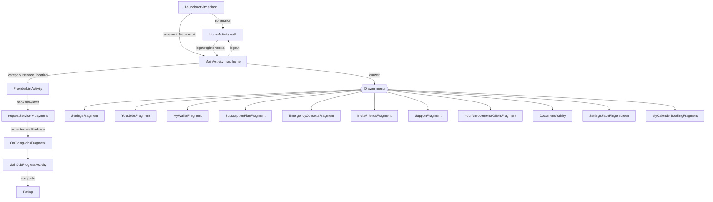

# InstaGuard User App — Navigation & Screen-by-Screen Inventory

> Navigation flow, the host-activity/fragment model, and a per-screen reference.
> APIs referenced here are detailed in [`USER_API_DOCUMENTATION.md`](./USER_API_DOCUMENTATION.md).

---

## 1. Navigation architecture (how it actually works)

The app is **fragment-heavy on top of a few host Activities**. There is **no Navigation Component / nav graph**; fragments are swapped manually via `Utils.switchContent(containerId, TAG, activity, args, AnimationType)` — a large `switch` over TAG strings in `Utils.java` that instantiates the fragment and tracks `Utils.CURRENT_TAG`.

### Host activities & their fragment containers
| Activity | Role | Fragment container | Hosts |
|----------|------|--------------------|-------|
| `LaunchActivity` | Splash + session routing + biometric unlock | — | none |
| `HomeActivity` | **Auth landing** (logged-out) | `R.id.frame_launch_container` | LoginFragment, RegisterFragment, ForgotPasswordFragment, SocialSignupFragment |
| `MainActivity` | **Main app** (map home + left drawer) | `R.id.frame_mainactivity` | Settings, EditSettings, YourJobs, MyWallet, Subscription, OnGoingJobs, Emergency, InviteFriends, Support, Offers/Announcements, SubCategory, ScheduleTrip, ProviderList(frag), PlacesAutoComplete, Calendar, etc. |
| `ProviderListActivity` | Guard list + booking request | (also hostable as `FRAGMENT_PROVIDERLIST`) | GuardUniqueIdFragment (bottom sheet) |
| `MainJobProgressActivity` | Live/active job, payment, chat/call, rating | — | payment/rating dialogs |
| `DocumentActivity` | Document upload/view | — | — |
| `SettingsFaceFingerscreen` | Biometric enable | — | — |
| `HomeMainActivity` | Stub (26 lines, effectively unused) | — | — |

### Inter-screen data passing
- **Booking inputs:** SharedPreferences store `MY_PREFS_REQUEST_STATE` (`B_*` keys) — **not** Intent extras.
- **Activity launches** use Intent extras only for: `MainJobProgressActivity` (`from`, `booking_id`, `customer_location`), `DocumentActivity` (`from`), and notification routing (`Notify`).
- **Fragment args** use `Bundle` with `B_*` keys for support pages, wallet recharge, schedule-trip edit, etc.

### Authentication guard / role checks
- **Session gate** = presence of `SP_USERID` (checked in `LaunchActivity`). No token-expiry gate at launch.
- **Firebase node check:** a logged-in user must also have a `users/<id>` node, else routed back to `HomeActivity`.
- **No multi-role logic** in this app — it is user-only. Guard is a separate app.
- **Feature gates** (conditional screens): `customer_manage_document==1` forces `DocumentActivity` in the booking flow; `SP_COMMON_ADMIN_PAYPAL_STATUS`, `SP_COMMON_WALLET_STATUS`, `SP_COMMON_SUBSCRIPTION_STATUS` toggle payment options/ features; currency-not-set blocks Wallet.

### Deep links / intent-based navigation
- `paypalpay://` return (scheme `paypalpay`, host `com.instaguard.user`) → `ProviderListActivity` / `MainJobProgressActivity`.
- Facebook login custom-tab scheme.
- FCM push click → `LaunchActivity` (general) or `MainJobProgressActivity` (Twilio call).

---

## 2. Top-level navigation flow

### Drawer menu (hosted in `MainActivity`, `NavigationView`)
| Menu id | Destination |
|---------|-------------|
| `nav_myprofile` | `FRAGMENT_SETTINGS` (Profile) |
| `nav_yourjobs` | `FRAGMENT_YOURJOBS` |
| `nav_mywallet` | `FRAGMENT_MYWALLET` (blocked if currency unset) |
| `nav_subscription_plans` | `FRAGMENT_SUBSCRIPTION_PLAN` |
| `nav_ongoingjob` | `FRAGMENT_ONGOINGJOBS` |
| `nav_emergencycontact` | `FRAGMENT_EMERGENCY_CONTACTS` |
| `nav_invitefriends` | `FRAGMENT_INVITEFRIENDS` |
| `nav_support` | `FRAGMENT_SUPPORT` |
| `nav_notification` | `FRAGMENT_YOUR_OFFERS_ANNOCEMENTS` |
| `nav_language` | language dialog |
| `nav_currency` | currency dialog |
| `menu_finger` | `SettingsFaceFingerscreen` |
| `nav_managedocument` | `DocumentActivity` (extra `from=vehicle`) |
| `nav_my_event_booking` | `FRAGMENT_MY_CALENDER_BOOKING` |

> Header shows name, wallet balance, rating, customer id, avatar. There is **no bottom navigation** — navigation is drawer + in-screen buttons + tabbed ViewPagers (YourJobs, Wallet transactions, Offers/Announcements).

---

## 3. Screen-by-screen inventory

> Format: **class** · file · purpose · entry · nav-to · APIs · models · storage · actions · validation · permissions.
> Paths are under `app/src/main/java/com/instaguard/user/`.

### Splash
- **LaunchActivity** · `Activities/LaunchActivity.java` · splash, session routing, biometric unlock, FCM token fetch · **entry:** launcher · **nav-to:** `HomeActivity` or `MainActivity` · **APIs:** none (reads Firebase `users/<id>`) · **storage:** reads `SP_USERID`, `spFinger*`; writes `SP_DEVICE_ID`(regid), defaults `SP_CURRENCY` · **actions:** fingerprint unlock · **perms:** POST_NOTIFICATIONS.

### Auth (host: HomeActivity)
- **HomeActivity** · `Activities/HomeActivity.java` · auth landing, social SDK orchestration, language/currency dialogs, app-settings bootstrap · **entry:** from Launch · **nav-to:** fragments below, then `MainActivity` · **APIs:** `customer/socialAdd`, `appsetting`, LinkedIn `userinfo` · **perms:** location/contacts/storage/phone/camera requested here.
- **LoginFragment** · `Fragments/LoginFragment.java` · email/phone + password login · **APIs:** `auth/login` · **models:** LoginNewModel/UserData · **storage:** writes token + profile; remember-me · **validation:** email-or-phone regex, password non-empty · **nav-to:** MainActivity / ForgotPassword / Register.
- **RegisterFragment** · `Fragments/RegisterFragment.java` · signup · **APIs:** `emailAvailable` → `auth/register` · **models:** RegisterModel · **validation:** name `[a-zA-Z\s]+`, libphonenumber, email, password `(?=.*[a-z])(?=.*[0-9]).{8,}`, terms checkbox · **nav-to:** Login.
- **ForgotPasswordFragment** · `Fragments/ForgotPasswordFragment.java` · email-OTP reset · **APIs:** `forgetpass` → `verifyotp` → `updatePassword` · **nav-to:** Login.
- **SocialSignupFragment** · `Fragments/SocialSignupFragment.java` · complete social signup · **APIs:** `customer/socialUpdate` · **nav-to:** MainActivity.

### Main / map (host: MainActivity)
- **MainActivity** · `Activities/MainActivity.java` (~4,481 lines) · map home, category/service pick, location pick, guard count, banners, drawer, SOS, logout · **APIs:** `appsetting`, `Categories`, `Service`, `getbanners`, `customerongoing`, `savepanic`, `emergencyContactGET`, `auth/logout` · **models:** VehicleCategory*, VehicleSubCategory*, BannerModel, OnGoingJobsModel · **storage:** writes `MY_PREFS_REQUEST_STATE` `B_*` · **nav-to:** ProviderListActivity, drawer fragments, DocumentActivity · **perms:** ACCESS_FINE/COARSE_LOCATION (code 3) · **validation:** guard count ≥2 for Book Now, currency configured.
- **SubCategoryFragment** · `Fragments/SubCategoryFragment.java` · alternate service list + Book Now/Later entry · **APIs:** `Service` · **nav-to:** ProviderList / ScheduleTrip.
- **PlacesAutoCompleteFragment** · `Fragments/PlacesAutoCompleteFragment.java` · pickup/drop location search · **APIs:** Google Places `json` + Geocode · **returns:** lat/lng to MainActivity.
- **ScheduleTripFragment** · `Fragments/ScheduleTripFragment.java` · Book Later date/time + availability · **APIs:** `availabilityCheckService` · **storage:** `B_SCH_TRIP_DRIVERID`, date/time · **nav-to:** ProviderList · **SDK:** materialdatetimepicker.

### Guard list & booking
- **ProviderListActivity** · `Activities/ProviderListActivity.java` (~4,494 lines) · nearby guard list (GeoFire), fare, promo, payment select, create booking · **APIs:** `FareEstimate`, `checkPromoCode`, `appsetting`, `requestService` (ridenow), `customerTimeout`, `notifysend`, `scheduledBooking`(dead) · **Firebase:** GeoFire `drivers_location`, `providers/<id>`, `users/<id>/trips/accept_status` · **models:** ProviderListData, SendRequestModel/ServiceRequest, FareEstimateData, CheckPromoData · **storage:** reads `MY_PREFS_REQUEST_STATE`; writes payment map · **perms:** location · **deep link:** `paypalpay`.
- **GuardUniqueIdFragment** · `Fragments/GuardUniqueIdFragment.java` · add guard by reference id (bottom sheet) · **APIs:** `driverReferenceIdValidate` · **models:** UniqeIdResModel.

### Active job
- **MainJobProgressActivity** · `Activities/MainJobProgressActivity.java` (~9,525 lines) · live tracking, timeline, ETA, extend, chat, call, payment settle, cancel, rating, SOS · **APIs:** `ExtraCalFare`, `UpdateJob`, `requestService`(payment_success), `Paycard`, `createOrder`, `Paypaypal`, `customerTripPayment`, `cancelJobs`, `CustomerFeedbackStore`, `StripePayment3DApp`, `StripeSaveCardPayment3DApp`, `chatAccessToken`, `accesstoken`, `message_notify`, `savepanic`, `appsetting` · **Firebase:** `booking_trips/<id>`, `drivers_location/<id>`, `direction/<id>`, `providers/<id>` · **SDKs:** Stripe, PayPal, Google Pay, Twilio · **intent extras:** `from`, `booking_id`, `customer_location` · **deep link:** `paypalpay`, Twilio `ACTION_INCOMING_CALL`.

### Jobs history (host: MainActivity)
- **YourJobsFragment** · `Fragments/YourJobsFragment.java` · 2-tab pager (Past, Request/Upcoming).
- **YourJobsUpcomingFragment** · `Fragments/YourJobsUpcomingFragment.java` · paginated requests/upcoming · **APIs:** `CustomerUpcomingJob` (offset, page 8), cancel via `requestService`(customer_cancel)/`scheduledcancelJobs` · **models:** RideHistoryModel/Data.
- **YourJobsPastFragment** · `Fragments/YourJobsPastFragment.java` · past jobs + detail dialog + rating · **APIs:** `pastjobs`, `CustomerFeedbackStore` · **models:** PastJobsModel/Data.
- **OnGoingJobsFragment** · `Fragments/OnGoingJobsFragment.java` · ongoing list · **APIs:** `customerongoing`, `cancelJobs`, `scheduledcancelJobs` · **nav-to:** MainJobProgressActivity.
- **MyCalenderBookingFragment** · `Fragments/MyCalenderBookingFragment.java` · WebView calendar (`CALENDER_WEB_URL + userId/base64(date)`) · **APIs:** none.

### Wallet (host: MainActivity)
- **MyWalletFragment** · `Fragments/MyWalletFragment.java` · balance (Firebase), add-money entry · **Firebase:** `users/<id>/wallet`,`/balance_amount`, `currency/USD` · **nav-to:** StripePaymentFragment (recharge — disabled), YourWalletTransactionFragment, Support · **validation:** amount > balance, USD > $0.50.
- **StripePaymentFragment** · `Fragments/StripePaymentFragment.java` · wallet recharge · **⚠️ Stripe code commented out — non-functional** · **APIs (intended):** `customerAddMoney`, `appsetting`.
- **YourWalletTransactionFragment** · 3-tab pager (All / Money In / Money Out).
- **YourWalletTransAll/MoneyIn/MoneyOutFragment** · transaction lists · **APIs:** `Transaction` (client-side credit/debit filter) · **models:** WalletAllData/TransactionModel.
- **WalletTermsFragment** · wallet terms text.

### Subscription (host: MainActivity)
- **SubscriptionPlanFragment** · `Fragments/SubscriptionPlanFragment.java` · list/buy plans, auto-renew, active status · **APIs:** `subscriptionList`, `createCheckoutSession` (Stripe WebView), `checkSubscription`, `updateAutoRenew`, `profileView` (active plan), `buySubscription`(superseded), `subscriptionGetList`(stub) · **Firebase:** `users/<id>/subs_buy_status` · **models:** ListViewSubsData, BuyPlanWebHookData, ProfileData.
- **SubscriptionPlanHistoryFragment** · `Fragments/SubscriptionPlanHistoryFragment.java` · history + disable renew · **APIs:** `subscription_history`, `updateAutoRenew` · **models:** SubsHistoryData.

### Profile / settings (host: MainActivity)
- **SettingsFragment** · `Fragments/SettingsFragment.java` · view profile, delete account · **APIs:** `profileView`, `delete_account_request`, `delete_account_confirm` · **nav-to:** EditSettings.
- **EditSettingsFragment** · `Fragments/EditSettingsFragment.java` · edit profile, avatar, change password, language/currency · **APIs:** `updateprofile`, `picupload`, `auth/passwordChange`, `profileView`, `appsetting` · **perms:** camera/gallery · **validation:** name regex, password regex.
- **SettingsFaceFingerscreen** · `FingerPrint/Activity/SettingsFaceFingerscreen.java` · enable fingerprint (Face = "Under Construct") · **storage:** `spFinger*`/`spFace*` (MY_PREFS_NAME_NEW).

### Emergency / invite / support / offers / documents
- **EmergencyContactsFragment** · `Fragments/EmergencyContactsFragment.java` · add/view/delete (max 5) · **APIs:** `emergencyContactCustomer`, `emergencyContactGET`, `emergencyContactDelete` · **perms:** READ_CONTACTS.
- **InviteFriendsFragment** · `Fragments/InviteFriendsFragment.java` · share invite code · **APIs:** none · **storage:** `SP_USER_INVITE_CODE`.
- **SupportFragment** · `Fragments/SupportFragment.java` · page list; Tawk FAB (hidden/GONE) · **APIs:** `pages` · **nav-to:** SupportSubFragment.
- **SupportSubFragment** · `Fragments/SupportSubFragment.java` · page HTML body · **APIs:** `Support`.
- **YourAnnocementsOffersFragment** · tab host (Offer / Announcement).
- **YourOffersFragment** / **YourAnnocementFragment** · `Fragments/...` · **data source: Firebase** `Notifications/Offers|Announcements/user` (status==1) · **APIs:** none.
- **DocumentActivity** · `Activities/DocumentActivity.java` (~1,530 lines) · upload/view/re-upload docs (Base64) · **APIs:** `manageCustomerDocument`, `customerViewDocument`, `customerImageUpload`, `customerDocumentUpdate`, `customerProofReupload` · **perms:** camera/storage · **gate:** `customer_manage_document==1`.

---

## 4. Screen ↔ primary API matrix

| Screen | Primary APIs |
|--------|--------------|
| Launch | (Firebase) |
| Home/Login/Register/Forgot/Social | auth/login, emailAvailable, auth/register, forgetpass, verifyotp, updatePassword, customer/socialAdd, customer/socialUpdate, appsetting |
| MainActivity | appsetting, Categories, Service, getbanners, customerongoing, savepanic, auth/logout |
| ScheduleTrip | availabilityCheckService |
| ProviderList | FareEstimate, checkPromoCode, driverReferenceIdValidate, requestService, customerTimeout, notifysend |
| MainJobProgress | ExtraCalFare, UpdateJob, requestService(payment_success), Paycard, createOrder, Paypaypal, customerTripPayment, cancelJobs, CustomerFeedbackStore, StripePayment3DApp, StripeSaveCardPayment3DApp, chatAccessToken, accesstoken, message_notify, savepanic |
| YourJobs (Upcoming/Past) | CustomerUpcomingJob, pastjobs, scheduledcancelJobs, requestService(customer_cancel), CustomerFeedbackStore |
| OnGoingJobs | customerongoing, cancelJobs, scheduledcancelJobs |
| Wallet / Transactions | Transaction (Firebase balance); customerAddMoney (disabled) |
| Subscription | subscriptionList, createCheckoutSession, checkSubscription, updateAutoRenew, subscription_history, profileView |
| Settings / Edit | profileView, updateprofile, picupload, auth/passwordChange, delete_account_request, delete_account_confirm |
| Emergency | emergencyContactCustomer/GET/Delete |
| Support | pages, Support |
| Offers/Announcements | (Firebase) |
| Documents | manageCustomerDocument, customerViewDocument, customerImageUpload, customerDocumentUpdate, customerProofReupload |
